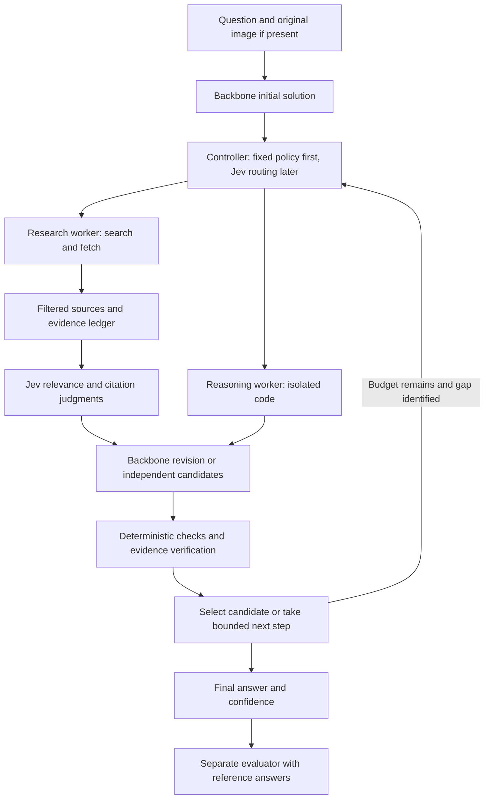

# Research and implementation plan

Research checked: October 28, 2026. All architecture choices, budgets, and milestones below are proposals. There are no measured project results yet.

## 1. Objective and first experiment

Build a reproducible harness that accepts credentials for one or more reasoning-model providers and uses Jev to make focused decisions within a search-and-solve workflow.

Test two hypotheses separately:

1. **System improvement:** the complete system answers more questions correctly than a raw call to the same backbone model.
2. **Jev improvement:** adding Jev improves accuracy or reduces cost at comparable accuracy relative to the same agent without Jev, under controlled resource budgets.

The recommended first experiment is **one backbone + web/code tools + Jev passage reranking and citation verification**. Start with a fixed workflow so routing and stopping policies do not confound the first comparison. Then test adaptive routing, candidate selection, and multiple providers one at a time. Build a persistent RAG corpus only if retrieval diagnostics justify it.

Do not assume that Jev can certify advanced proofs or identify the correct answer from arbitrary candidates. Its value here is a hypothesis about many small, evidence-grounded decisions.

## 2. Benchmark definition and evaluation tracks

HLE-Diamond was introduced on September 22, 2026 as a refined HLE subset with **1,000 questions: 500 reasoning and 500 knowledge**. It supports both closed-book and tool-enabled evaluation. Earlier HLE studies concern a different collection and cannot supply directly comparable Diamond scores. [Official introduction](https://agi.safe.ai/blog/hle-diamond).

The dataset identifier is `cais/hle-diamond`, with a `test` split and a `partition` field. Access requires accepting the Hugging Face conditions. Preserve image inputs and original identifiers. Download through an authenticated preparation command, pin a dataset revision, and record schema and content hashes. Do not put question text, images, answer keys, or question-bearing traces into GitHub. [Dataset card](https://huggingface.co/datasets/cais/hle-diamond).

Define three explicitly labeled tracks:

| Track | Purpose | Permitted system behavior |
| --- | --- | --- |
| Closed-book | Measure the raw model and sampling baselines | No web or retrieved corpus; state the exact inference budget |
| Controlled web+code | Primary agent and Jev experiment | Follow the pinned official tool restrictions; use a documented custom harness |
| Extended retrieval | Evaluate persistent RAG or additional specialist tools | Publish separately, listing every protocol departure |

For controlled web+code, reproduce the official sandbox and wrappers: network-disabled Python 3.11.16 with pinned packages; only `web_search` and `web_fetch` for external information; no added specialist solvers or OCR tools. Search returns at most 20 results before filtering. Fetch returns text/Markdown capped at 60,000 characters and marks truncation. Enforce the upstream blocklist on queries, URLs, snippets, fetched content, and cache hits, including proxy/archive bypass checks. Reject long verbatim question searches and log blocked calls. Pin the exact rules and dependency files used. The published tool results use provider-specific harnesses; our custom orchestration remains a distinct system even with matching tool restrictions. [Official tool protocol](https://github.com/centerforaisafety/hle/blob/main/docs/evaluation-with-tools.md), [pinned sandbox packages](https://github.com/centerforaisafety/hle/blob/main/docs/requirements-tools.txt).

Do not expose benchmark partition labels, reference answers, rationales, or grading metadata to the solver. Partition labels are for sampling and reporting, not privileged routing signals. A text-only pilot must be labeled as a subset and cannot stand in for the complete benchmark.

## 3. Existing work and how to use it

| Work | Relevant finding or contribution | Design implication and limitation |
| --- | --- | --- |
| [Self-Consistency Improves Chain of Thought Reasoning](https://arxiv.org/abs/2203.11171) | Samples multiple solutions and aggregates their answers | Include a same-model sampling baseline; agreement can still reflect shared mistakes |
| [Deep Researcher with Test-Time Diffusion](https://arxiv.org/abs/2507.16075) | Iterates between retrieval and revision of a working draft | Maintain an evolving evidence ledger and unresolved questions; adapt the pattern to short answers rather than copying a report-writing workflow |
| [Asymmetric Verification for Deep Search](https://arxiv.org/abs/2510.06135) | Studies verification combined with sequential and parallel inference; longer sequential search can degrade results | Test independent candidate generation plus bounded verification; the reported search-task gains do not establish Jev's ability to verify HLE reasoning |
| [Tongyi DeepResearch](https://github.com/Alibaba-NLP/DeepResearch) | Open implementation and research material for deep research agents | Inspect search orchestration and evaluation machinery before reinventing them; trained agent models are not equivalent to a generic API wrapper |
| [Search-Time Data Contamination](https://arxiv.org/abs/2508.13180) | Shows that search can expose benchmark answers and inflate measured performance | Treat retrieval auditing and label isolation as core evaluation components |
| [TypeSafe reranking cookbook](https://docs.typesafe.ai/cookbooks/rerank_typesafe) | Demonstrates semantic reranking of a lexical shortlist on legal passages | Adapt the retrieval-then-judge decomposition; validate it on our evidence tasks rather than transfer the cookbook's numerical gains |
| [TypeSafe citation-check cookbook](https://docs.typesafe.ai/cookbooks/citation_check) | Combines deterministic quote matching with a semantic support judgment | Use exact span validation before Jev checks claim support; this tests grounding, not whether every source is correct |

These sources motivate the architecture. This review did not establish a reproduced result showing that **Jev plus an API reasoning model improves HLE-Diamond**. Treat that combined claim as the research contribution to test, not a premise. Keep historical benchmark results in their original settings rather than assembling a misleading cross-benchmark leaderboard.

## 4. Architecture

Use an explicit asynchronous state machine with typed records and bounded loops. An agent framework is optional; the experiment should remain understandable without one.



**Backbone responsibilities:** interpret the problem, produce queries, derive solutions, write code, identify claims and supporting spans, and generate the final answer. Request concise verification material and tool artifacts; do not depend on access to a provider's private reasoning trace.

**Jev responsibilities:** judge supplied state against explicit criteria. Jev does not generate search queries, proof steps, or prose. The controller determines admissible actions, enforces budgets, and executes tools.

**Search-worker responsibilities:** pursue a specific unresolved fact, collect primary sources, track provenance, and return evidence. Initially this is a role of the same backbone. A second independently prompted research worker is a later experiment; more agents consume the same total budget.

**Evaluator responsibilities:** access reference labels only after predictions are finalized. Run separately from the solver and its tools, with distinct storage and credentials where feasible. Never send grading feedback back into an active held-out solve.

## 5. Jev pipeline contracts

The current API accepts `state`, a model identifier, and named `questions` at `POST /v1/systemone`. Use `typesafe-sdk` and `AsyncTypeSafeClient`, supplied with `TYPESAFE_API_KEY`. Record actual returned model and usage. Use a pinned model such as `jev-1.14.0` after checking account availability; avoid a moving alias in reported experiments. [API](https://docs.typesafe.ai/api/system-one), [Python SDK](https://docs.typesafe.ai/sdk/python).

| Stage | State supplied | Judgment | Controller behavior |
| --- | --- | --- | --- |
| J1: tool routing, later | Question, initial candidate, explicit unresolved gaps, available actions | Separate Noul questions for evidence need and numerical-check usefulness; Choice among admissible next actions, including direct/uncertain | Route to search, code, another solve, or stop; first benchmark against a fixed policy |
| J2: passage reranking, MVP | Subquestion plus a fetched passage and its metadata | Score: irrelevant / background only / supports part / directly addresses the missing fact | Select a diverse evidence set within the context budget; retain score and confidence |
| J3: citation support, MVP | Atomic claim, exact quote, and surrounding source text | Choice: supported / contradicted / insufficient | Reject fabricated spans in code first; request new evidence or revision for unresolved critical claims |
| J4: candidate constraints, later | Candidate, explicit problem requirements, supporting artifacts | Separate Noul or Choice checks for units, requested scope, assumptions, and evidence consistency | Flag narrow failures for deterministic validation or backbone revision |
| J5: answer comparison, later | Anonymized candidate answers and verification summaries | Choice over candidate IDs plus none-supported; optionally judge pairwise equivalence | Use as a selector only after measuring performance against voting and a reasoning-model judge |
| J6: bounded continuation, later | Unresolved gaps, previous action results, remaining resource envelope | Choice among another search, independent solve, targeted check, finalization | Enforce a calibrated policy and hard limits; do not equate confidence with expected value of another call |

These are proposed application judgments, not prebuilt Jev endpoints. Their prompts and thresholds need development-set validation.

Use the primitives correctly:

- **Choice** selects among alternatives. Include a no-match outcome where all candidates may fail. Do not confuse a winner's probability with the probability that the whole solution is correct. [Choice documentation](https://docs.typesafe.ai/primitives/choice).
- **Noul** returns a yes probability, with no separate confidence. A value near 0.5 represents uncertainty between yes and no, not medium severity. **Choice/Score confidence** describes distribution concentration. Validate its relationship to downstream errors. [Confidence documentation](https://docs.typesafe.ai/confidence).
- **Score** uses ordered descriptive levels. Its returned scale follows the level positions; with four levels, normalize by three if a 0–1 feature is needed. It is not a correctness probability. [Score documentation](https://docs.typesafe.ai/primitives/score).

Batch independent questions sharing a state. Dependent decisions require another request after new evidence arrives. Keep passages local to their relevant subquestions instead of repeatedly sending the full transcript. [Fan-out pattern](https://docs.typesafe.ai/patterns/fan-out).

Current standard Jev limits are 64k tokens per request and 32k per question; long context is opt-in and carries documented quality/latency tradeoffs. The current model page lists $0.042 per million input tokens with free output tokens. Recheck at implementation time and use measured billed usage in reports. Use the reasoning provider's vision support for original images; do not make the first release depend on experimental Jev image support. [Model reference](https://docs.typesafe.ai/models).

Before using Jev as a final selector, measure how often it rejects a correct candidate or chooses an incorrect one. Remove or narrow that stage if it harms accuracy, even when its judgments look confident.

## 6. Search and retrieval design

### Search loop

1. Generate a small set of factual subquestions from the unresolved solution, without benchmark names or long copied question spans.
2. Search through the audited wrapper. Filter snippets before any model sees them; filter complete fetched content again.
3. Prefer original papers, official documentation, and authoritative reference sources where relevant. Record inaccessible sources as unavailable rather than treating snippets as complete evidence.
4. Preserve section boundaries, equations, tables, publication dates, and locatable text offsets during parsing. Keep both source text and any model summary.
5. Apply J2 to a shortlist, initially at most 20 passages per retrieval round. Select a compact evidence packet, initially up to six passages, with duplicate-origin controls.
6. Generate or revise a solution; use J3 on critical source-dependent claims. A separate verification query should seek counterevidence when a material conflict remains.
7. Stop on hard budgets or when the fixed workflow finishes. Add adaptive stopping only after comparison with the fixed baseline.

The initial counts are tuning candidates, not optimal values. Search results are untrusted data: retrieved instructions cannot change the tool policy, read secrets, or access evaluator files. The network-disabled code sandbox has no dataset directory or API credentials. These boundaries must hold regardless of what Jev predicts.

### RAG in two stages

**Stage A: per-question evidence store.** Store filtered pages and passages for one solve. This already supports retrieval-augmented generation and provenance without maintaining a broad corpus. Clear answer-bearing memory across questions and experimental arms. A replay cache may be used for paired retrieval experiments if it is identical across arms and is labeled separately from live-search evaluation.

**Stage B: frozen reference corpus.** Add this only to the extended track. Build a versioned, licensed collection of relevant reference documents; exclude benchmark questions, solution collections, prior run answers, and synthetic benchmark explanations. Index lexical and dense representations, fuse candidate ranks, then apply J2. Preserve source hashes, ingestion date, chunking version, and embedding model version.

Test lexical-only, hybrid retrieval, and hybrid-plus-Jev separately. Measure retrieval recall on independently labeled evidence tasks, not just final benchmark accuracy. A reranker cannot recover a missing passage. If retrieval is weak, fix query formation, coverage, parsing, or chunking before adding more verification calls.

Avoid a knowledge graph and cross-run answer memory in the MVP. Both increase implementation and contamination complexity before their benefit is established.

## 7. Candidate generation and compute allocation

Start with one provider and pin its model version, reasoning effort, sampling settings, and supported token limits. An API key alone does not specify model capabilities: the adapter needs explicit configuration and capability checks for images, tools, structured output, and usage reporting.

Later, generate independent candidates before sharing their conclusions. Compare same-model diversity with heterogeneous providers under the same total spend. An expensive verifier is another model call and must be counted.

Normalize exact answers conservatively. Use symbolic or numerical checks only where the problem permits them, including units and assumptions. Require consistent clustering for free-form answer equivalence; pairwise judgments can be nontransitive. An executed program is evidence about its implemented calculation, not proof that it modeled the original problem correctly.

Measure candidate-set oracle accuracy offline: did any candidate contain a correct answer? Compare this diagnostic ceiling with the selector's realized accuracy. Never let oracle labels participate in inference. Poor oracle accuracy calls for better generation; a large oracle-to-selected gap calls for better selection.

Illustrative pilot limits are three candidate solutions, two research rounds, six search calls, eight fetches, three code executions, and a ten-minute item deadline. Also require explicit per-item and total-run dollar caps before any paid run. Reserve room for finalization and retries. Tune these on development tasks and freeze before held-out evaluation; do not silently truncate a raw baseline to make the agent look better.

## 8. Experimental design

### Evaluation matrix

| Arm | Configuration | What it measures |
| --- | --- | --- |
| B0 | One raw model call, no tools | User-facing reference baseline |
| B1 | Same model, independent samples and answer aggregation, no tools | Benefit from extra inference alone |
| B2 | Same model with audited web/code tools, fixed workflow, no Jev | Benefit from tools and orchestration |
| J2 | B2 plus Jev passage reranking only | Evidence-selection effect |
| J3 | B2 plus Jev citation checks only | Grounding-check effect |
| J23 | B2 plus both components | Combined effect and interaction |
| Jfull | J23 plus routing, selection, and stopping, introduced separately | Adaptive control effect |
| M / R | Best frozen configuration plus multiple providers / persistent RAG | Later extensions, reported separately |

Add a small generative-model verifier and a simple retrieval-ranking baseline as alternatives to Jev. Compare components first on identical saved candidates/evidence, then run end-to-end comparisons where judgments can change the trajectory.

Report both an equal-workload comparison and a comparison at matched total cost. Count tokens, reasoning tokens where reported, search/fetch charges, Jev, embeddings, compute, retries, and selection calls. Equal tokens across providers do not imply equal cost or capability. Show accuracy versus dollars and latency across several frozen budget settings.

### Development and holdout discipline

- Prefer independent expert-level development tasks with checked answers. Remove overlap with Diamond, including paraphrases and image variants. Original HLE is not automatically independent because Diamond is derived from it.
- If Diamond itself must support development, preregister a local stratified split, such as 200 development and 800 held-out questions. Label this as an internal split, not an official benchmark split. Tune only on development items; report the held-out result and sample count distinctly.
- A full 1,000-question result after tuning on 200 of them is descriptive, not a fully untouched test result. The cleanest full-benchmark experiment freezes policies using external development data first.
- Freeze prompts, model IDs, corpus, blocklist, budgets, calibration mappings, and seeds before final evaluation. Do not inspect held-out answers to decide which variant to publish.

### Scoring and analysis

Adapt the official prediction format and grading implementation, pinning their commit and grader configuration. Diamond should be an explicit dataset selection, not an accidental use of the original HLE default. Keep grading separate from Jev's internal verification; using Jev as both selector and outcome judge would confound the experiment. [Prediction harness](https://github.com/centerforaisafety/hle/blob/main/hle_eval/run_model_predictions.py), [grading harness](https://github.com/centerforaisafety/hle/blob/main/hle_eval/run_judge_results.py).

Primary outcome: accuracy over the entire declared evaluation set, including failures. Report knowledge/reasoning partitions, subject, answer format, and image/text slices when supported by the schema. Also report mean and tail latency, total and per-item cost, timeout/error rate, and cost per correct answer.

Use paired item-level accuracy differences with 95% bootstrap confidence intervals; use McNemar's test as a paired binary cross-check. With repeated runs, cluster by question rather than treating repeats as independent items. Predeclare the primary comparison and treat other ablations as exploratory or adjust for multiple comparisons. Estimate the sample size required for a meaningful gain from pilot discordance rates; a small pilot cannot substantiate a small percentage-point improvement.

Measure confidence calibration with Brier score and reliability plots on a declared mapping to correctness. Fit any mapping only on independent/development labels. Report coverage and accuracy if the system abstains; an abstention remains incorrect for ordinary full-set accuracy. Do not substitute Jev confidence for final-answer confidence without validation.

Audit a blinded sample of grading decisions, especially disagreements and mathematical equivalents. Freeze any adjudication rule across all arms. Track provider failures separately; allow a bounded, symmetric retry policy and do not silently drop difficult or failed items.

### Contamination accounting

Apply filters before a source reaches any worker. Keep a private source audit with queries, source hashes, filter versions, matched rules, and exposure flags. Domain blocking alone is insufficient; answer mirrors and snippets can leak labels. [Search-time contamination study](https://arxiv.org/abs/2508.13180).

If leakage is found after exposure, flag the run, repair the filter, and restart the affected item with fresh state under the frozen rerun policy. Report attempted, exposed, and rerun counts. Show all-item outcomes and a separately labeled sensitivity analysis; do not make accuracy look better by quietly excluding contaminated or difficult cases. Retrieval controls cannot establish that a model's pretraining was uncontaminated.

## 9. Proposed implementation structure

Use Python with async I/O, typed validation, and a CLI. Start with a local event store and private JSONL artifacts; a distributed queue or hosted dashboard is unnecessary for the first experiment.

```text
src/jev_solver/
  benchmarks/       # Dataset adapters; solver-safe views
  providers/        # Reasoning-model and Jev adapters
  controller/       # State machine, budgets, stopping policies
  tools/            # Search/fetch enforcement and sandbox broker
  retrieval/        # Evidence store, chunking, optional hybrid index
  judgments/        # Versioned Jev questions and local composition rules
  candidates/       # Generation, normalization, clustering, selection
  evaluation/       # Isolated grading and paired analysis
  tracing/          # Usage accounting, provenance, export redaction
configs/            # Frozen experiment definitions
tests/fixtures/     # Synthetic tasks and sanitized mock responses
reports/            # Aggregate publication artifacts
```

Minimum records: `QuestionView`, `EvidencePassage`, `Candidate`, `Judgment`, `ToolEvent`, `BudgetState`, `Prediction`, and `Grade`. A `QuestionView` contains only solver-authorized input. A passage includes URL, source hash, offsets, retrieval time, and filtering outcome. A prediction references its run/config hash; only the evaluator joins it to a reference label.

Planned CLI operations: validate configuration, prepare data, dry-run cost estimates, run an experiment, resume interrupted items, grade finalized predictions, compare arms, and export a sanitized report. These commands are not implemented yet.

Cache keys must include model version, complete request hash, prompt version, parser version, and filter version where applicable. Record whether calls were live or replayed. Keep provider-specific adapters where protocols differ; do not assume all services are OpenAI-compatible.

Use bounded concurrency, backoff with retry limits, cancellation, durable checkpoints, and idempotent resume. Reserve estimated cost before dispatching concurrent calls, then reconcile with billed usage. The supervisor owns credentials; task code cannot read them. A Jev outage follows a declared fallback policy and is counted, not silently treated as a successful judgment.

## 10. Milestones and acceptance gates

Indicative effort: roughly five to seven focused engineering weeks, plus evaluation time, dataset access, and API-rate-limit delays. These are planning estimates, not delivery commitments.

| Phase | Work | Completion gate |
| --- | --- | --- |
| 0 — protocol, 2–3 days | Pin dataset/evaluator/tool rules; choose backbone and search backend; freeze data boundaries and spend caps | Synthetic end-to-end fixture runs; no labels reachable by solver; manifest complete |
| 1 — baselines, 4–5 days | Implement provider adapter, grading, usage ledger, B0/B1 | Resumable runs and correct multimodal handling; identical grading across arms |
| 2 — tools, 4–5 days | Audited search/fetch, sandbox, evidence ledger, B2 | Tests cover snippets, proxies, redirects, cache bypass, sandbox isolation, and budget cancellation |
| 3 — Jev MVP, 4–5 days | Implement J2/J3 and paired component experiments | Relevant-evidence and support judgments evaluated on labeled development cases; end-to-end deltas reported even if negative |
| 4 — adaptive experiments, 4–7 days | Add routing, selection, stopping; optionally a second provider | Each addition beats or justifiably trades off against its simpler baseline; no promotion based solely on prompt anecdotes |
| 5 — frozen evaluation, 3–5 days plus runtime | Final paired runs, error analysis, contamination audit, publication exports | Reproducible manifest, confidence intervals, complete cost accounting, and sanitized artifacts |
| Optional — persistent RAG | Frozen corpus and hybrid retrieval in an extended track | Retrieval recall and final accuracy improve sufficiently to justify ingestion and maintenance cost |

Meaningful tests should target contracts and failure modes: dataset-label isolation, image preservation, budget enforcement under concurrency, malformed responses, retries/resume, filtering before model exposure, citation offsets, consistent answer clustering, and evaluation accounting. CI uses synthetic examples and mocks; paid benchmark evaluation is an explicitly launched job.

## 11. Publication and decision criteria

Publish the architecture, pinned configs, prompts, dependency locks, synthetic fixtures, aggregate results, cost model, and reproducibility instructions. Keep keys, downloaded datasets, fetched caches, question-bearing outputs, and evaluator labels private. Audit exported reports for reconstructed questions and answer leakage as well as literal dataset rows. Include citations and attribution for reused code; select a project license before release.

Every result should identify dataset revision and scope, date, backbone/Jev/grader versions, tool policy, budget, number of trials, confidence interval, failures, contamination flags, and protocol departures. Separate measured results from proposed settings. Do not describe this custom system as an official leaderboard submission unless one is actually accepted.

Advance the claim that Jev improves the system only if the preregistered comparison supports it. Prefer a meaningful accuracy gain at matched cost, or a declared noninferiority margin with a meaningful cost reduction. If gains come entirely from web/code tools or extra inference, report that clearly. If Jev improves retrieval but worsens final selection, retain the useful component and remove the harmful one.

The first deliverable should answer a narrow, useful question: **does Jev improve evidence handling in a controlled HLE-Diamond agent enough to justify its integration?** That result determines whether more elaborate routing, ensembles, and RAG are worth building.
