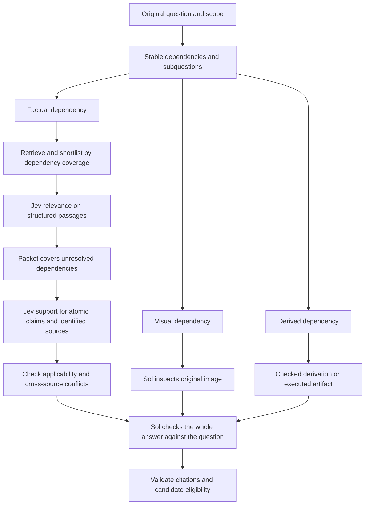

# Jev and Sol citation failures and harness changes

The saved evidence supports three changes to investigate: preserve useful passages through retrieval, give Jev smaller and better structured relevance and support tasks, and make Sol verify the connection between a sourced fact and the answer actually requested. Improving only the search provider, lowering one relevance threshold, or making every audit stricter would leave several demonstrated failures intact.

This analysis follows the [expanded component review](EVIDENCE_V3_EXPANDED_REVIEW.md) and the [historical integration investigation](EVIDENCE_V3_SEARCH_ATTRIBUTION.md). It joins the original inputs, citations, judgments, candidate histories, Terra/Haiku reviews and 41 Astra checks. New offline analysis reproduced **153 of 153 historical research packets** across the two 50-item runs, identified their exact exclusion conditions, and compared selected claims across different citation contexts. No new provider calls were made; original traces, grades and unresolved labels remain unchanged.

The distinction between an observed mechanism and a semantic diagnosis matters here. Code and trace replay establish which gate excluded evidence or a candidate. Reviewer agreement strengthens a proposed reading of a source but is not adjudicated truth. Jev records choices, scores and probabilities, not an explanation of why it chose them. Explanations about its table reading or attention are therefore hypotheses to test. None of these component findings measures the accuracy gain from a repair.

## Evidence through each stage

J2 means passage relevance; J3 means source support for a claim. Sol generates the drafts, dependency inventories, revisions, visual and derivation checks, and final selection. Jev performs J2/J3 in these runs. It does not inspect the images. The repository controls fetching, shortlisting, packet assembly, citation validation and eligibility.

The expanded review contains 1,516 passage occurrences across 18 selected aliases. Its four mutually exclusive passage stages are:

| Historical stage | Passage occurrences | Valid Terra reviews | Terra calls partial or direct | Responsible boundary |
| --- | ---: | ---: | ---: | --- |
| Omitted before Jev | 1,029 | 980 | 156 | Lexical shortlist |
| Excluded by relevance policy | 378 | 367 | 68 | Jev score plus repository admission policy |
| Admitted by relevance policy, omitted from packet | 37 | 36 | 31 | Packet assembly |
| Retained in a research packet | 72 | 70 | 58 | Available for downstream use |

These are occurrences, including repeated rounds and sources, rather than independent question errors. Partial evidence need not suffice for an answer. Two of the 31 potentially useful packet omissions are exact text duplicates of retained passages; they do not represent loss of unique text.

Among 141 valid J3 reviews, Terra disputed 28 saved decisions: 24 supported → insufficient, two supported → contradicted, and two changes in the opposite direction. They span nine aliases; ten occur in historically correct runs. Among 151 valid audit reviews, Terra flagged 53 as under-restrictive and one as over-restrictive. The reviewers disagreed on the main audit diagnosis in 97 of 150 valid pairs. These counts identify inspection targets, not false-support or wrong-answer acceptance rates.

## Why useful citations never reached Jev

The historical shortlist has 12 slots across all fetched passages in a round. [Retrieval code](../src/jev_solver/retrieval/evidence.py) ranks by literal word overlap with `missing_fact`, then rotates among queries and source URLs. It does not score semantic usefulness before making that cut.

Three omissions checked by Astra show the exact mechanism:

| Alias and backend | Useful passage rank within its own source | Source ranks admitted to shortlist | What the passage supplies |
| --- | ---: | --- | --- |
| `input_large_image/brave` | 9 | 1–4 | The named phenomenon, stimulus description and perceptual ambiguity |
| `malformed_revision_citation/brave` | 12 | 1–6 | The theorem's construction, field, rank and dimension quantifier |
| `malformed_revision_citation/perplexity` | 20 | 1–4 | The theorem's field, fraction, rank and dimension quantifier |

All three passages were already fetched, and all three received direct-relevance judgments from Terra and Astra. The first source's highest-ranked chunk begins with bibliography material. The theorem passages express key parameters in symbols that do not necessarily repeat the planner's descriptive words. The observed failure is the shortlist ordering and cutoff; calling these Jev rejections assigns responsibility to a component that never received them.

**Change to test:** reserve some of the same 12 slots for headings, definitions, theorem statements and tables associated with unresolved dependencies. Compare a hybrid or semantic shortlist with the lexical baseline on the same complete fetched passage sets. Preserve source offsets and enough neighboring context to interpret a statement. Measure recall before Jev separately from J2 accuracy. Increasing Jev's sophistication cannot recover a passage excluded upstream.

## Why Jev excluded readable instruction tables

Two `input_visual_program/perplexity` sources illustrate relevance failures with a concrete admission mechanism:

| Saved source | Jev relevance score | Jev confidence | Terra / Haiku / Astra relevance | Historical decision |
| --- | ---: | ---: | --- | --- |
| Community instruction table | 0.4833 | 0.40 | direct / partial / direct | Excluded |
| Language author's instruction table | 0.4300 | 0.43 | direct / partial / direct | Excluded |

Both tables contain the requested command mappings. The actual J2 inputs retain pipe separators and row order, but have substantial whitespace and weak association between headers and cells. Haiku explicitly questioned table readability. In the first request, `missing_fact` also asks for an official source; the passage supplies a mapping without establishing official provenance. The evidence supports representation and task-scope hypotheses, not a claim that Jev's internal reason is known.

The admission rule is definite: [filter_relevance](../src/jev_solver/judgments/pipeline.py) requires score ≥ 2/3, or score ≥ 1/3 with confidence ≤ 0.20 for a bounded alternative slot. Neither passage qualifies. The provider's four-level score is normalized by three; a mixture of partial and background assessments can fall below 2/3 even when the passage contributes a needed fact. For illustration, 80% mass on partial and 20% on background gives a normalized mean of 0.60. That is a policy property, not an observed error rate.

Simply replacing the mean with the probability mass on partial/direct would not necessarily rescue these examples: their saved useful-category masses are only 0.46 and 0.32. A change to representation or task decomposition also needs testing. Confidence has not been calibrated against adjudicated labels.

**Change to test:** preserve table headers and cells as explicit rows with source-coordinate mappings. Ask J2 whether a passage supplies any necessary subfact, independently of whether it completes the whole answer. Keep provenance requirements as a separate check. Calibrate admission and bounded reconsideration on labeled passages; avoid lowering every threshold merely to admit these two cases.

## Why relevant passages disappeared after Jev

The additional replay narrows the expanded review's general “packet limit” explanation:

| Exact first exclusion condition | Historical research packet omissions across 100 items | Terra partial/direct omissions in the selected review |
| --- | ---: | ---: |
| Two passages already retained from the same hostname | 45 | 29 |
| Exact duplicate text already retained | 3 | 2 |
| Six-passage limit or character limit | 0 | 0 |

The replay matches all 153 research packet ID sequences. [diverse_packet](../src/jev_solver/retrieval/evidence.py) imposes a hard two-passage allowance per hostname, in addition to the configured six-passage and 12,000-character limits. It treats a publication platform or repository hostname as the diversity unit. Complementary definitions and theorem details can therefore lose to earlier passages even when space remains. One direct passage in `input_large_image/brave` scored 0.84 and still hit this gate. These counts concern research-stage assembly; the controller's subsequent merging of revision evidence is a separate boundary.

**Change to test:** allocate packet space by unresolved dependency and distinct supporting information, using hostname diversity as a preference rather than an absolute ceiling. Allow complementary passages from one paper or platform when needed. Preserve exact-text deduplication. Raising the six-passage or character limit alone does not address the observed first exclusion condition; relaxing the host rule may expose those other limits and must still respect them.

## Why Jev accepted claims broader than their citations

The [support prompt](../src/jev_solver/judgments/pipeline.py) asks for an atomic claim, but the interface accepts any claim string. Actual requests contain conjunctions, strengthened quantifiers, interpretation choices and causal assertions. The three-way choice supplies no clause-by-clause explanation to the caller.

| Citation family | What the supplied text establishes | What the saved claim adds | Observed result and diagnosis |
| --- | --- | --- | --- |
| `math_convention/brave` | A definition with algebraic factorization **and a finite factor-norm bound** | Only algebraic factorization is required, combined with an action-convention claim | Jev: supported; Terra, Haiku and Astra: contradicted by the supplied definition |
| `malformed_revision_citation/brave` | A theorem with its original asymptotic expression | A transformed expression with a different placement of the asymptotic bound | Jev: supported repeatedly; Terra and Astra: the transformation is not established; Haiku also rejects support on the stronger-checked example |
| `selection_gene_id/perplexity` | A deletion prevents the reported degradation phenotype | The affected reaction is specifically the pathway-entry step | Jev: supported; Terra and Astra: insufficient for that mechanistic relationship |
| `truncated_initial/perplexity` | A source describes two different constructions | One of them is the construction intended by the question | Jev: supported; Terra and Astra: source description does not establish intended identity |
| `source_temporal_scope` | Sources describe commencement, coverage conditions, or an earlier proposal | Broad applicability or absence of restrictions not explicitly resolved in a particular excerpt | Several disputed J3 decisions; stronger reviews disagree by claim and context |

The repeated asymptotic mismatch belongs to one alias/backend history, not several independent failures. The gene example supports a narrower claim about the observed phenotype; rejecting its added mechanism does not establish that the named target is wrong. In the definition example, the candidate carrying the disputed J3 claim still ended ineligible. The final selected candidate reframed the convention as a derived dependency. Fixing that one J3 verdict would therefore not by itself demonstrate recovery of the final answer.

Some disputed support decisions have high saved confidence, so a low-confidence fallback cannot catch the entire class. Conversely, the definition example was accepted with support probability 0.49 and confidence 0.24: the current J3 caller uses the returned category without a separate uncertainty escalation rule.

**Change to test:** decompose the claim into its identity, relation, scope, quantifier and qualification requirements. Ask Jev for support of each factual requirement against identified source passages. A source that establishes one clause cannot pass the entire conjunction. Route algebraic transformations to a checked derivation, and keep “this source describes X” separate from “the question is asking about X.” Preserve `insufficient` versus `contradicted`: an unproved strengthening is not automatically false.

## Why different citation contexts produced different J3 decisions

In `input_visual_program/brave`, the exact same claim about the output instructions received:

| Request path | Supplied source text | Jev decision |
| --- | --- | --- |
| Citation verification | One 2,277-character passage | supported |
| Factual dependency audit | The identical passage followed by another source, totaling 4,677 characters | insufficient |

The first source text is an exact prefix of the second request's source context. The second request additionally includes the original question and source metadata. Terra, Haiku and Astra all support the claim in that larger context. The discrepancy makes request shape and source combination specific test targets. It does not isolate context length as the cause: question context, metadata and the model sample also changed.

The two paths are visible in [citation verification](../src/jev_solver/judgments/pipeline.py) and [dependency verification](../src/jev_solver/judgments/verification.py). The latter concatenates passage text with blank lines and sends a separate list of IDs/URLs. It does not ask for a verdict keyed to each passage. This is also a weak interface for distinguishing an earlier proposal from a later rule when both occur in one bundle.

**Change to test:** use one explicit support contract for both paths, with an atomic claim and individually identified source blocks. Obtain local entailment before checking cross-source consistency and applicability. Test the single passage, the passage plus unrelated material, and the passage plus genuinely conflicting material separately. A local supported verdict must not bypass a relevant contradiction elsewhere. Changed prompts require fresh judgments; the historical pair is a diagnostic, not a controlled comparison.

## Why Sol passed the wrong scope or rejected a defensible scope

**A conditional solution can pass without establishing its applicability.** In `truncated_initial/perplexity`, all three reviewers agree on one audit's failure: the source and derivation establish results for a particular construction, but the audit never establishes that this is the construction requested. That run's final outcome was nevertheless graded correct. This is evidence of a missing interpretation check, not a lost benchmark point.

In `selection_clinical_id`, citations establish the general role of a procedure, while the candidate acknowledges that the question has already described it as completed. Sol still accepts the asserted intended answer. A general reference cannot establish which part of an internally difficult question the author intended to ignore. The historical wrong outcome and Terra's diagnoses support investigating chronology and answer scope; clinical/reference correctness still needs adjudication.

In `math_convention`, a factual convention becomes a derived premise in a later draft. A sound conditional calculation can then pass without resolving whether its chosen convention answers the original question. The current inventory checks artifact existence and declared IDs, but has no persistent graph requiring every later derivation to retain the interpretation assumptions it depends on.

**Sol also strengthens the obligation beyond the actual claim.** In `selection_population_id/brave`, Terra and Astra find that an audit blocks a qualified potential explanation by requiring a stronger terminology link. Astra rejects Terra's under-restrictive diagnosis for another candidate from the same alias. Candidate-specific wording changes the correct obligation; one verdict per question would hide this distinction.

**Dependency kind changes the required tools.** In `audit_music_scope`, the same initial answer qualifies through visual inspection and arithmetic in Brave, while Perplexity adds critical source requirements for notation conventions and eventually abstains. This demonstrates scope instability, not that every added factual check was wrong. A fixed policy should distinguish elementary symbolic reasoning, direct observations and facts that require retrieval. Requiring execution for every small symbolic calculation would introduce another unnecessary barrier.

**Citations cannot verify an image or a complete algorithm.** Both `no_search_algorithm` runs finish with graded wrong answers despite no search or Jev calls. Those outcomes belong to Sol's interpretation, visual/derivation review and selection path. In `visual_lattice`, Astra and Haiku consider the inspected audit adequate while Terra does not. Keep the image/reference dispute open rather than training Jev on Terra's allegation.

**Change to test:** establish a persistent question contract before drafting: requested output, scope, quantifiers, chronology, permitted qualifications and necessary interpretation assumptions. Link every sub-answer to that contract. Preserve factual assumptions when a revision calls its reasoning “derived.” Make a final independent check ask whether the verified facts and derivation answer that contract. For a potential explanation, check possibility; for an exact identification or unique choice, check that stronger requirement. Source support alone cannot settle intended interpretation.

## Citation mechanics and existing repairs

The clearest preventable candidate loss remains `art_citation_offsets/brave`. Jev retained the decisive source and supported the corrected claim. Three corrected drafts failed because their character offsets did not match an exact quotation present in the retained passage. Coverage passed, but no candidate was eligible. The paired Perplexity answer was graded correct. The validator correctly rejected the spans; Sol's output and the repair workflow failed to produce the valid representation.

Generate citation coordinates deterministically from an exact, uniquely located quote tied to the saved passage and source hash, or expose stable span IDs for Sol to select. Reject absent and ambiguous matches and recheck claim support after repair. This reduces a serialization burden without relaxing verification.

The working tree already contains several changes from the earlier test-plan work. They should not be presented as new proposals or as measured benchmark gains:

| Boundary | Current implementation status |
| --- | --- |
| Candidate-qualified dependency IDs | Exact, selected-candidate resolution exists in [selection.py](../src/jev_solver/candidates/selection.py) |
| Explicit request to fetch an unused lead | `fetch_urls`, allowed-lead validation and follow-up reserve exist in [research.py](../src/jev_solver/controller/research.py) |
| Gap mapping and retained dependency IDs | Validation exists in [verification.py](../src/jev_solver/judgments/verification.py) |
| Citation offsets | Exact validation and one bounded model repair exist; automatic unique-quote coordinate recovery is absent |
| Oversized contexts | Conservative envelope checks and diagnostics exist; dependency-aware compaction is absent |
| Malformed citations and truncated generation | Rejected and tested; successful bounded live recovery remains unmeasured |

The eight historical solver errors also include three input-envelope failures, three selection-ID failures, one malformed citation and one truncated initial response. They are separate from citation semantics. The [implementation results](EVIDENCE_V3_TEST_RESULTS.md) record existing regression coverage. A recoverable selection error can conceal a wrong answer as well as a correct one, so recovery counts must not be reported as accuracy gains.

## Proposed decomposition and routes

The harness already asks for atomic dependencies and neutral queries. The improvement is to enforce and preserve their structure, rather than add another general instruction to “break down the question.” Start with these bounded routes:

| Question or evidence pattern | Subquestions | Jev's role | Sol or tool role |
| --- | --- | --- | --- |
| Table plus image interpretation | What does each required table entry say? What values are actually visible? What follows from those observations? | J2 on needed entries; J3 on each sourced rule | Inspect original image; derive or execute behavior from checked observations and rules |
| Mathematical theorem | Which definition/version? What field, bound, quantifier and construction guarantee? Is the rewritten expression justified? | Relevance and entailment of each stated parameter | Check transformation and applicability to the question; preserve assumptions |
| Mechanistic identification | What identity is stated? What relation is demonstrated? What intervention effect is observed? | Separate identity, relation and effect support | Decide which supported relationship is necessary for the requested answer |
| Time-dependent rule | Which version/date? Which scope conditions? Which case satisfies each condition? | Entailment within an identified version and source | Apply conditions to each case and reconcile conflicting sources |
| Interpretation or multiple-choice ambiguity | What is given? What is requested? Is the claim conditional, possible or unique? | Support external facts only | Check the interpretation and all answer-changing assumptions against the original question |

For example, replace one missing fact asking for a theorem's rank, field, fraction and quantifier with separate dependency records for those parameters. A paragraph giving the field can now be useful without containing the rank. The parent conclusion passes only after every necessary parameter and its application are checked. Split input/output table entries similarly; do not require the table passage itself to solve the image program.

Keep stable dependency IDs, parent IDs, source spans, interpretation assumptions and verification states. Deduplicate shared premises and prioritize unresolved critical leaves. The existing 12-dependency, three-query and two-search limits mean decomposition cannot grant each leaf a fresh full budget. Compare routes with the same total allowance; separately account for any intervention that increases it. Optional explanatory claims should be narrowed or removed if they are unsupported and unnecessary, while necessary premises remain mandatory.



## Priority and measurements

1. **Finish deterministic evidence and citation boundaries.** Retain the existing selection/fetch fixes, add coordinate recovery and bounded context construction, then test shortlist and hostname-policy changes separately. Observe exact-source survival and newly eligible candidates; do not infer their correctness from eligibility.
2. **Test J2 representation and J3 decomposition independently.** For J2, hold fetched material and packet budgets fixed. For J3, cross single/multiple source contexts with original/decomposed claims, including conflicting-source controls. Use the original table, definition, asymptotic and mechanism cases plus fresh adjudicated examples. Do not combine all interventions into one unexplained score change.
3. **Test Sol's question contract and dependency stability.** Include qualified explanations that should not be over-constrained, conditional derivations missing applicability, chronology conflicts, image checks and valid independent solutions. Assess the whole candidate history, not just the eligible pool.
4. **Measure benchmark impact with matched arms.** Run the predeclared B2/J23 comparison on all 50 development questions, blocking by backend, with identical implementation, initial drafts, source snapshots and budgets. Both arms retain verification. Test integration and routing changes as separately identified interventions; isolate J2/J3 if needed. Regenerate downstream audits/revisions/selection whenever their full inputs change. Report paired full-set accuracy, wrong answers, coverage, errors, cost and uncertainty, then freeze the policy before a fresh evaluation.

Use adjudicated passage/claim labels for semantic error rates. Keep duplicate-text removal separate from lost unique information, missing judgments separate from rejections, and intermediate discrepancies separate from final-answer errors. Preserve the positive `art_citation_offsets` Jev checks and the adequate stronger-reviewed audits in `aria_title`, `selection_population_id` and `visual_lattice` as controls against indiscriminate tightening.

## Coverage of the selected cases

The case aliases below cover the entire expanded-review selection. This is a mechanism index, not 18 confirmed semantic failures.

| Alias | Main boundary to investigate |
| --- | --- |
| `art_citation_offsets` | Corrected factual answer lost at exact-span validation; positive J2/J3 control |
| `selection_gene_id` | Identity versus pathway mechanism; separate selection-ID failure |
| `selection_population_id` | Qualified possibility versus stronger causal obligation; packet host cap; separate selection-ID failure |
| `selection_clinical_id` | Sourced general procedure versus question chronology and intended choice; separate selection-ID failure |
| `input_visual_program` | Table structure, J2 admission and differing J3 contexts; separate input-envelope failure |
| `input_large_image` | Direct text omitted by shortlist and host cap; input-envelope failures in both runs |
| `malformed_revision_citation` | Theorem shortlisting, asymptotic strengthening and malformed citation output |
| `truncated_initial` | Unestablished construction identity despite conditional mathematical support; separate truncated initial response |
| `audit_music_scope` | Unstable classification of visual, symbolic and externally sourced premises |
| `missed_paper_lead` | Planned paper never fetched in one run; partial bounds versus complete answer |
| `aria_title` | Source destination and complete entity attribution; stronger review rejects the alleged audit defect |
| `visual_lattice` | Image-to-option application and disputed reference/visual assessment |
| `no_search_algorithm` | Sol-only visual, derivation and interpretation path; no executed Jev decision |
| `math_convention` | Definition contradiction, chosen convention and factual-to-derived transition |
| `inference_underdetermined` | Supported background fact versus requested inference; tool/interpretation assumptions need adjudication |
| `source_temporal_scope` | Version, scope, negative claims and application to individual cases |
| `subsumption_scope` | Algorithm assumptions, conditional reasoning and requested answer scope; reference dispute unresolved |
| `source_claim_identity` | Dependency identity and packet omissions despite historically correct outcomes; useful control |

## Reproduction and private source trail

Exact source URLs, passage IDs, claim text, request hashes, reviewer quotations and selected source snapshots are in [private evidence notes](../private/v3-citation-failure-analysis-2026-11-05/evidence-notes.md). The [machine-readable dossier](../private/v3-citation-failure-analysis-2026-11-05/evidence-dossier.json) joins 362 records: all 337 original flags, all 41 stronger checks, and one additional same-claim citation control, with overlaps retained only once by record ID. The [analysis output](../private/v3-citation-failure-analysis-2026-11-05/analysis.json) contains stage counts, the full alias inventory and input hashes.

Run from the repository root:

```bash
.venv/bin/python private/v3-citation-failure-analysis-2026-11-05/analyze.py
```

The script reads frozen inputs and writes only this new private analysis directory. It verifies all 153 packet sequences, the same-claim context inclusion, and unchanged hashes for all six original artifact inputs. Private artifacts are ignored and must accompany any internal handoff; public docs intentionally omit question text, reference answers and per-item prediction text. This work changes documentation and creates derived private evidence, not solver behavior or benchmark scores.
